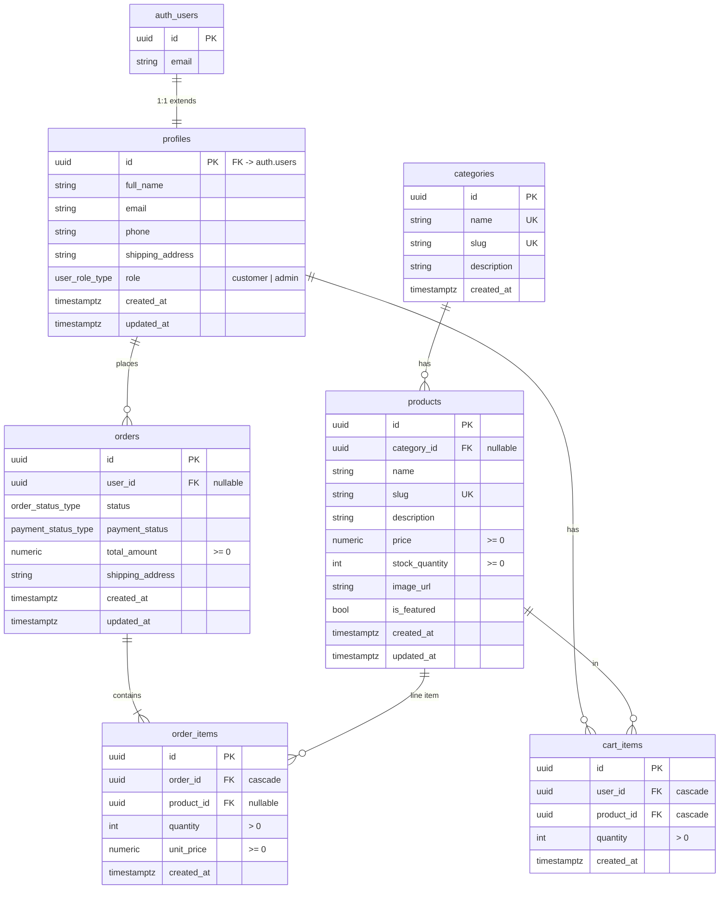

# Database & backend schema

Backend: **Supabase** (hosted Postgres 15+ with Auth and Row Level Security).
All DDL lives in `supabase/*.sql` and is applied through the Supabase SQL editor.
The TypeScript mirror of this schema is `src/lib/types/database.types.ts`.

## Entity relationship diagram

## Enums

| Enum                  | Values                                                    |
| --------------------- | --------------------------------------------------------- |
| `order_status_type`   | `pending`, `processing`, `shipped`, `delivered`, `cancelled` |
| `payment_status_type` | `unpaid`, `paid`, `refunded`                              |
| `user_role_type`      | `customer`, `admin`                                       |

## Tables

### `profiles` — extends `auth.users` (1:1)
Created automatically by the `on_auth_user_created` trigger on signup.

| Column             | Type            | Notes                          |
| ------------------ | --------------- | ------------------------------ |
| `id`               | `uuid` PK       | FK → `auth.users.id`, on delete cascade |
| `full_name`        | `text`          | nullable                       |
| `email`            | `text`          | not null                       |
| `phone`            | `text`          | nullable                       |
| `shipping_address` | `text`          | nullable                       |
| `role`             | `user_role_type`| default `customer`             |
| `created_at` / `updated_at` | `timestamptz` | default `now()`     |

### `categories`
| Column | Type | Notes |
| ------ | ---- | ----- |
| `id` | `uuid` PK | default `gen_random_uuid()` |
| `name` | `text` | not null, unique |
| `slug` | `text` | not null, unique |
| `description` | `text` | nullable |
| `created_at` | `timestamptz` | default `now()` |

### `products`
| Column | Type | Notes |
| ------ | ---- | ----- |
| `id` | `uuid` PK | default `gen_random_uuid()` |
| `category_id` | `uuid` FK → `categories.id` | nullable, on delete set null |
| `name` | `text` | not null |
| `slug` | `text` | not null, unique |
| `description` | `text` | nullable |
| `price` | `numeric(10,2)` | not null, check `>= 0` |
| `stock_quantity` | `integer` | not null, default 0, check `>= 0` |
| `image_url` | `text` | nullable |
| `is_featured` | `boolean` | default false |
| `created_at` / `updated_at` | `timestamptz` | default `now()` |

### `orders`
| Column | Type | Notes |
| ------ | ---- | ----- |
| `id` | `uuid` PK | default `gen_random_uuid()` |
| `user_id` | `uuid` FK → `profiles.id` | nullable, on delete set null |
| `status` | `order_status_type` | default `pending` |
| `payment_status` | `payment_status_type` | default `unpaid` |
| `total_amount` | `numeric(10,2)` | not null, check `>= 0` |
| `shipping_address` | `text` | not null |
| `created_at` / `updated_at` | `timestamptz` | default `now()` |

### `order_items`
| Column | Type | Notes |
| ------ | ---- | ----- |
| `id` | `uuid` PK | default `gen_random_uuid()` |
| `order_id` | `uuid` FK → `orders.id` | not null, on delete cascade |
| `product_id` | `uuid` FK → `products.id` | nullable, on delete set null |
| `quantity` | `integer` | not null, check `> 0` |
| `unit_price` | `numeric(10,2)` | not null, check `>= 0` (price snapshot at purchase) |
| `created_at` | `timestamptz` | default `now()` |

### `cart_items`
| Column | Type | Notes |
| ------ | ---- | ----- |
| `id` | `uuid` PK | default `gen_random_uuid()` |
| `user_id` | `uuid` FK → `profiles.id` | not null, on delete cascade |
| `product_id` | `uuid` FK → `products.id` | not null, on delete cascade |
| `quantity` | `integer` | not null, check `> 0` |
| `created_at` | `timestamptz` | default `now()` |
| — | unique (`user_id`, `product_id`) | one cart row per product per user |

## Functions & triggers

| Object | Kind | Purpose |
| ------ | ---- | ------- |
| `handle_new_user()` | trigger fn (`security definer`) | inserts a `profiles` row from `auth.users` on signup |
| `on_auth_user_created` | trigger | fires `handle_new_user()` after insert on `auth.users` |
| `place_order(p_shipping_address, p_total_amount, p_items)` | RPC (`security definer`) | atomic checkout: inserts order + items, locks & decrements stock, clears cart (`supabase/place_order.sql`) |
| `is_admin()` | fn (`security definer`) | true when the caller's profile `role = 'admin'` (`supabase/admin_setup.sql`) |

## Row Level Security

RLS is enabled on all six tables. Base policies (from `schema.sql`):

| Table | select | insert | update | delete |
| ----- | ------ | ------ | ------ | ------ |
| `profiles` | own row | — | own row | — |
| `categories` | public | — | — | — |
| `products` | public | — | — | — |
| `orders` | own rows | own rows | — | — |
| `order_items` | items of own orders | — | — | — |
| `cart_items` | own rows | own rows | own rows | own rows |

Admin policies (from `admin_setup.sql`) add, gated on `is_admin()`:
insert/update/delete on `products` and `categories`, select/update on `orders`,
select on `order_items` and `profiles`.

Because clients can never update `orders`/`order_items`/stock directly, all
checkout writes go through the `place_order()` RPC, which runs as a single
transaction with `for update` row locks on the products being bought.

## SQL script order (fresh project)

1. `supabase/schema.sql` — enums, tables, RLS, trigger, starter seed
2. `supabase/place_order.sql` — checkout RPC
3. `supabase/admin_setup.sql` — admin role helper + admin policies
4. `supabase/seed_realistic_data.sql` — optional demo data

## TypeScript mapping

`src/lib/types/database.types.ts` declares a `Database` interface in the shape
produced by `supabase gen types typescript`, plus convenience row aliases
(`Profile`, `Category`, `Product`, `Order`, `OrderItem`, `CartItem`).
`src/lib/types.ts` re-exports them so application code imports one stable path.
